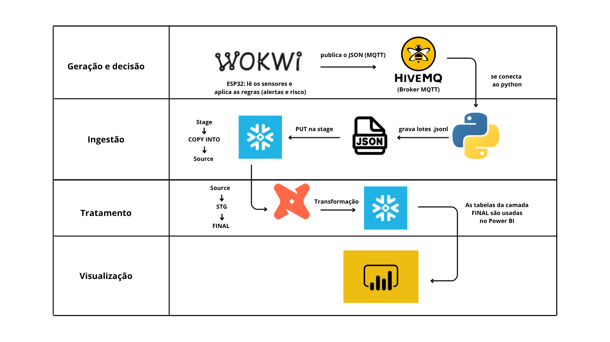
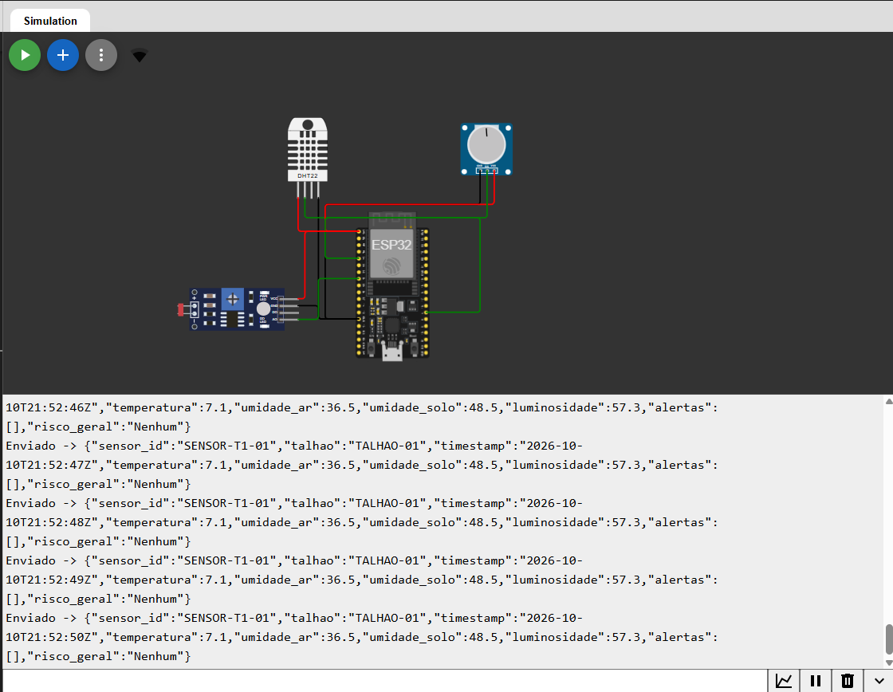
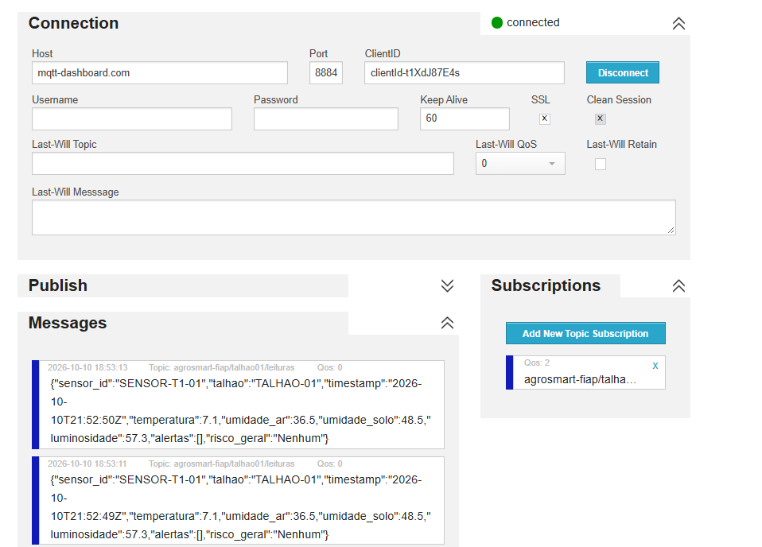
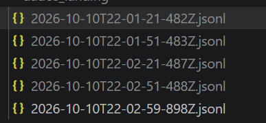
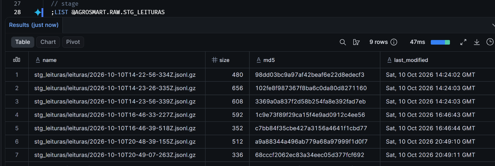
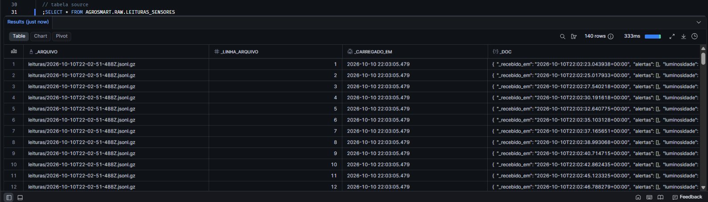
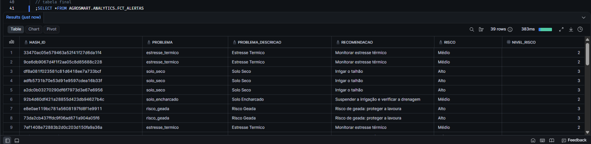
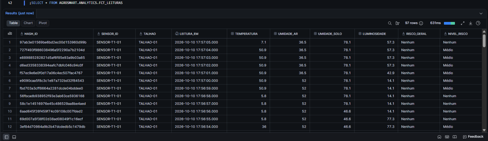
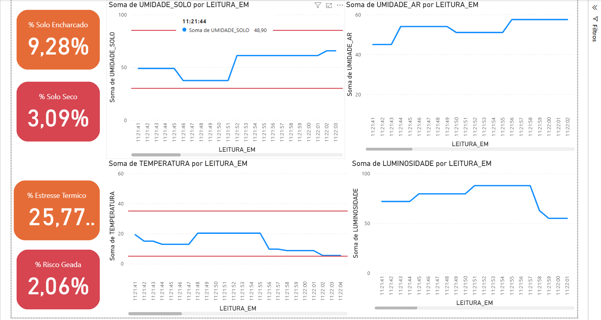
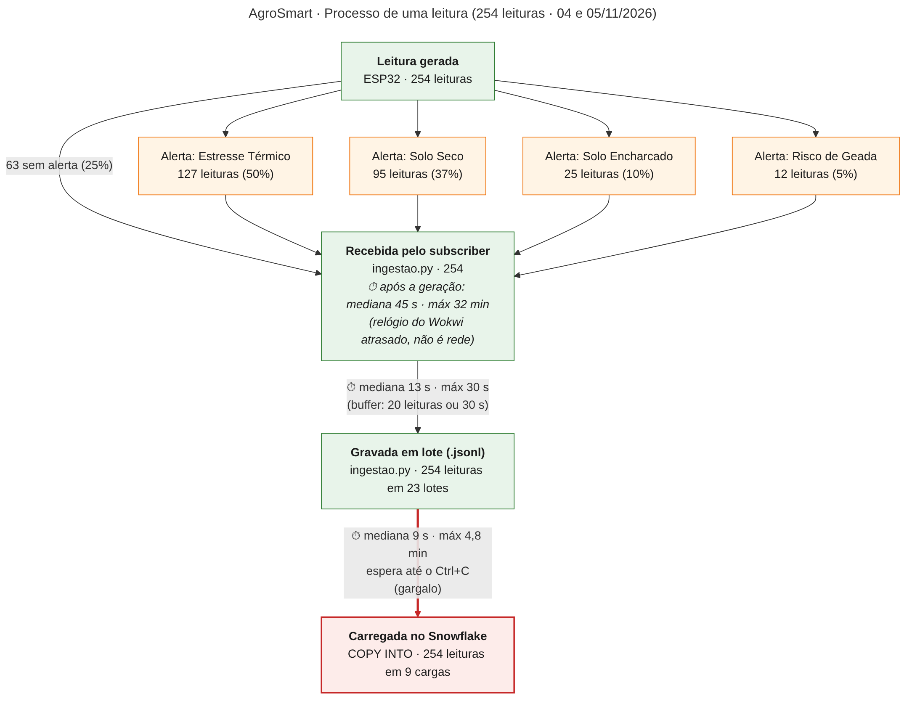

# 🌱 AgroSmart — Fase 7: Plataforma integrada de monitoramento da lavoura

> **Como está a saúde da minha lavoura e o que eu devo fazer agora?**

O AgroSmart usa tecnologia e dados para monitorar a lavoura e apoiar decisões no campo. Nesta Fase 6, a entrega foi fazer uma **pipeline de dados ponta a ponta**: os dados nascem em um sistema embarcado (simulado), são ingeridos, armazenados, tratados, passam por regras de decisão e terminam em um dashboard que mostra o que está acontecendo e o que fazer a seguir.

## 🧭 Grupo

| Nome | RM |
|------|----|
| Henrique Parra | RM551973 |
| Guilherme Barreto | RM97674 |
| Roberto Oliveira | RM551460 |
| Nicolas Oliveira | RM98939 |
| Marcos Vinicius | RM99894 |

---

## Arquitetura

<p align="center">
  
</p>

### Componentes

| Componente | Camada | Tecnologia | Função |
|------------|--------|------------|--------|
| Estação de campo | Geração e decisão | ESP32 (Wokwi), DHT22, LDR, potenciômetro | Lê os sensores a cada segundo, aplica as regras de decisão e publica o JSON com alertas e risco |
| Broker MQTT | Geração e decisão | HiveMQ (público) | Intermediário entre o ESP32 e o subscriber: recebe as mensagens no tópico e as repassa |
| Subscriber | Ingestão | Python (`paho-mqtt`, `snowflake-connector-python`) | Assina o tópico, acumula as leituras em lotes `.jsonl`, envia os arquivos para a stage e executa o `COPY INTO` |
| Logs da aplicação | Ingestão | Python `logging` | Registra a execução em `logs/ingestao.log`, com níveis, rotação e resumo final |
| Stage e tabela raw | Ingestão | Snowflake | Guarda os arquivos enviados e o JSON bruto em `RAW.LEITURAS_SENSORES` |
| Transformação | Tratamento | dbt | Converte o JSON em tabelas relacionais (STG → FINAL): `fct_leituras`, `fct_alertas` e `fct_event_log` |
| Dashboard | Visualização | Power BI | Mostra as leituras, a evolução no tempo e os alertas a partir da camada FINAL |
| Event log | Visualização | dbt + CSV | `fct_event_log` exportado em `event_log.csv`, base da [análise de processos](#-análise-de-processos) |

### Fluxo de dados

1. **Entrada:** o ESP32 lê os sensores a cada segundo, aplica as regras de decisão e publica um JSON com as medições, os alertas e o risco geral no tópico MQTT do HiveMQ.
2. **Ingestão:** o subscriber em Python recebe cada mensagem, acrescenta o horário de recebimento e acumula as leituras em lotes `.jsonl` (a cada 20 leituras ou 30 segundos). Ao encerrar, envia os arquivos para a stage do Snowflake (`PUT`) e carrega o JSON bruto na tabela `RAW.LEITURAS_SENSORES` (`COPY INTO`). Toda a execução fica registrada em `logs/ingestao.log`.
3. **Processamento:** o dbt executa SQL no próprio Snowflake. A camada STG transforma o JSON em colunas tipadas e abre a lista de alertas em linhas; a camada FINAL expõe as tabelas prontas para consumo. Os dados não saem do Snowflake nessa etapa.
4. **Saída:** o Power BI lê `fct_leituras` e `fct_alertas` e mostra o estado da lavoura e o que fazer. A `fct_event_log` é exportada em CSV e alimenta a análise de processos.

### Geração e Decisão

O sistema embarcado foi simulado no **Wokwi**, com um **ESP32** ligado a três sensores:

- **DHT22**: mede a temperatura e a umidade do ar;
- **LDR**: mede a luminosidade;
- **Potenciômetro**: simula a umidade do solo.

Ao iniciar a simulação, o **ESP32** se conecta ao **Wi-Fi**, lê os sensores e monta um **JSON** com cada leitura. Esse **JSON** é publicado em um tópico do **HiveMQ**, um **broker MQTT público**. O broker funciona como intermediário: recebe as mensagens do ESP32 e as repassa para quem assinou o tópico. Assim, quem produz o dado e quem consome não precisam se conectar diretamente.

#### Regras simples

| Condição | Risco | Recomendação | Por quê |
|----------|-------|--------------|---------|
| Umidade do solo < 30% | Alto | Irrigar o talhão | A planta começa a sofrer com a falta de água |
| Umidade do solo > 85% | Médio | Suspender a irrigação e verificar a drenagem | Solo encharcado sufoca as raízes e favorece doenças |
| Temperatura > 35 °C | Médio | Monitorar estresse térmico | Calor excessivo reduz a fotossíntese e o crescimento |
| Temperatura < 5 °C | Alto | Risco de geada: proteger a lavoura | Geada pode matar as plantas em poucas horas |

#### Decisão automática

As regras rodam **dentro do próprio ESP32**, a cada leitura (uma por segundo), sem nenhuma intervenção humana. O firmware lê os sensores, compara cada valor com os limites da tabela acima e já publica o JSON com:

- **`alertas`**: a lista de problemas detectados, cada um com o seu risco e a recomendação de ação;
- **`risco_geral`**: o maior risco entre os alertas da leitura, ou `Nenhum` quando nenhuma regra dispara.

As regras são independentes, então mais de uma pode disparar na mesma leitura (por exemplo, solo seco + estresse térmico). Como a decisão é tomada no dispositivo, na borda (*edge*), ela não depende da nuvem: o dado já sai do campo classificado, e as etapas seguintes só armazenam, tratam e exibem o que foi decidido.

A escala de risco tem quatro níveis: `Nenhum` (0), `Baixo` (1), `Médio` (2) e `Alto` (3). O nível `Baixo` está reservado para regras futuras; nenhuma regra atual o utiliza.

<p align="center">
    
    <br>
    <em>Circuito do ESP32 simulado no Wokwi, com DHT22, LDR e potenciômetro sendo simulado</em>
</p>

<p align="center">
    
    <br>
    <em>Broker MQTT recebendo os dados enviados pelo esp32</em>
</p>


### Ingestão

O script **Python** se conecta ao **HiveMQ**, assina o tópico e passa a receber cada leitura publicada pelo ESP32.

```json
{
  "sensor_id": "SENSOR-T1-01",
  "talhao": "TALHAO-01",
  "timestamp": "2026-10-09T15:00:40Z",
  "temperatura": 72.4,
  "umidade_ar": 64.5,
  "umidade_solo": 6,
  "luminosidade": 93.8,
  "alertas": [
    {
      "problema": "solo_seco",
      "risco": "Alto",
      "recomendacao": "Irrigar o talhão"
    },
    {
      "problema": "estresse_termico",
      "risco": "Médio",
      "recomendacao": "Monitorar estresse térmico"
    }
  ],
  "risco_geral": "Alto",
  "_recebido_em": "2026-10-09T15:01:34.227704+00:00"
}
```

Quando o buffer chega a 20 leituras ou passam 30 segundos, o que acontecer primeiro, as leituras são gravadas em um arquivo **.jsonl**, com um JSON por linha. Ao final da execução, o script se autentica no **Snowflake**, envia os arquivos para a **stage** e executa o `COPY INTO`, que carrega os dados brutos na tabela source.

<p align="center">
    
    <br>
    <em>Arquivo jsonl criado com todos os json recebidos do wokwi</em>
</p>

<p align="center">
    
    <br>
    <em>Depois de ter feito o upload do arquivo jsonl na stage</em>
</p>

<p align="center">
    
    <br>
    <em>Depois de ter feito o copy into e os dados dos arquivos jsonl na tabela do snowflake na source</em>
</p>

#### Logs da aplicação

O script de ingestão registra tudo o que acontece usando o módulo `logging` do Python. Cada linha tem data e hora, nível e componente, e é gravada em dois lugares:

- **console**: para acompanhar a execução em tempo real;
- **arquivo `logs/ingestao.log`**, na raiz do projeto: fica o histórico. O arquivo tem rotação: ao chegar em 5 MB vira `ingestao.log.1` e um novo é criado, mantendo no máximo 3 arquivos antigos.

| Nível | Quando é usado |
|-------|----------------|
| `DEBUG` | Cada leitura recebida do broker (uma por segundo) |
| `INFO` | Funcionamento normal: conexão, lote gravado, arquivo enviado, `COPY INTO` |
| `WARNING` | Algo fora do esperado, mas o sistema continua: mensagem inválida, queda do broker |
| `ERROR` | Falha: erro no envio para a stage, `COPY INTO` com erro, falha inesperada (com o *traceback* completo) |

O nível mínimo é definido pela variável `LOG_LEVEL` no `.env`: `INFO` (padrão) para um log enxuto, ou `DEBUG` para ver também cada leitura capturada.

Ao encerrar, o script registra um **resumo da execução**, que serve como indicador rápido de funcionamento: se `recebidas` e `linhas_carregadas` batem e não há arquivos com erro, nenhuma leitura se perdeu no caminho.

```
2026-11-05 00:40:56 | INFO    | ingestao  | iniciando ingestão | broker=broker.hivemq.com tópico=agrosmart-fiap/talhao01/leituras nível=INFO log=C:\repositorios\AgroSmart\logs\ingestao.log
2026-11-05 00:40:59 | INFO    | snowflake | conectado
2026-11-05 00:41:05 | INFO    | mqtt      | conectado, assinando: agrosmart-fiap/talhao01/leituras
2026-11-05 00:41:35 | INFO    | lote      | 14 leituras -> 2026-11-05T03-41-35-816Z.jsonl
2026-11-05 00:42:05 | INFO    | lote      | 14 leituras -> 2026-11-05T03-42-05-819Z.jsonl
2026-11-05 00:42:07 | INFO    | ingestao  | encerrando (Ctrl+C)...
2026-11-05 00:42:07 | INFO    | lote      | 1 leituras -> 2026-11-05T03-42-07-555Z.jsonl
2026-11-05 00:42:08 | INFO    | snowflake | 3/3 enviado(s)
2026-11-05 00:42:10 | INFO    | copy      | 29 linha(s) carregada(s) em AGROSMART.RAW.LEITURAS_SENSORES
2026-11-05 00:42:10 | INFO    | ingestao  | resumo | recebidas=29 inválidas=0 lotes=3 arquivos_enviados=3 arquivos_com_erro=0 linhas_carregadas=29 duração=0:01:13
```

Com `LOG_LEVEL=DEBUG`, cada leitura também aparece no log:

```
2026-11-05 00:41:06 | DEBUG   | mqtt      | recebido TALHAO-01 | 2026-11-05T03:41:06Z | temp=28.4°C ar=52.0% solo=25.1% luz=57.3% risco=Alto
```

### Tratamento

O **dbt** lê a tabela source e transforma os dados em camadas:

- **STG**: converte o JSON bruto em uma tabela relacional, com uma coluna para cada campo e os tipos corretos;
- **FINAL**: expõe os dados prontos para o consumo do Power BI.

<p align="center">
    
    <br>
    <em>Tabela alertas na camada final do dbt</em>
</p>

<p align="center">
    
    <br>
    <em>Tabela leituras na camada final do dbt</em>
</p>

### Visualização

O **Power BI** se conecta à camada FINAL no Snowflake e mostra os indicadores dos sensores, a evolução das leituras no tempo e os alertas gerados pelas regras de decisão. Assim, o produtor consegue responder à pergunta central do projeto: como está a saúde da lavoura e o que fazer agora.

<p align="center">
    
    <br>
    <em>Power bi usando as tabelas da camada final</em>
</p>

## 📈 Monitoramento

O sistema pode ser acompanhado em cada etapa do pipeline, do ESP32 ao Power BI, usando os logs da aplicação e consultas ao Snowflake:

| O que acompanhar | Onde olhar | Sinal de problema |
|------------------|------------|-------------------|
| Ingestão em tempo real | Console do `ingestao.py` | Linhas `WARNING` ou `ERROR` |
| Histórico da ingestão | `logs/ingestao.log` | No resumo final, `recebidas` diferente de `linhas_carregadas`, ou `arquivos_com_erro` maior que 0 |
| Cargas no Snowflake | Consulta ao `copy_history` | `STATUS` diferente de `Loaded` ou `ERROR_COUNT` maior que 0 |
| Transformação | Saída do `dbt run` | `ERROR` maior que 0 |
| Chegada de dados | Consulta da última leitura | Última leitura muito antiga enquanto o sistema deveria estar rodando |

### Logs da ingestão e do dbt

Descritos na seção [Logs da aplicação](#logs-da-aplicação): cada execução do `ingestao.py` registra conexões, lotes gravados, envios para a stage, o resultado do `COPY INTO` e, ao encerrar, um resumo com os totais. Um exemplo real está em [`docs/evidencias/ingestao_log.txt`](docs/evidencias/ingestao_log.txt), e a saída de uma execução do dbt em [`docs/evidencias/dbt_run.txt`](docs/evidencias/dbt_run.txt).

### Status das cargas no Snowflake

O Snowflake guarda automaticamente o histórico de todo `COPY INTO`, sem nenhum código adicional. A consulta abaixo lista cada arquivo carregado nas últimas 24 horas, com o horário, a quantidade de linhas, os erros e o status:

```sql
select file_name, last_load_time, row_count, error_count, status
from table(AGROSMART.information_schema.copy_history(
    table_name => 'AGROSMART.RAW.LEITURAS_SENSORES',
    start_time => dateadd(hour, -24, current_timestamp())
));
```

```
FILE_NAME                                    LAST_LOAD_TIME                  ROW_COUNT  ERROR_COUNT  STATUS
leituras/2026-11-05T21-10-51-050Z.jsonl.gz   2026-11-05 13:10:59.494 -0800   16         0            Loaded
leituras/2026-11-05T21-10-57-998Z.jsonl.gz   2026-11-05 13:10:59.494 -0800   4          0            Loaded
leituras/2026-11-05T04-21-11-000Z.jsonl.gz   2026-11-04 20:21:09.556 -0800   7          0            Loaded
leituras/2026-11-05T04-20-53-372Z.jsonl.gz   2026-11-04 20:21:09.556 -0800   16         0            Loaded
...
```

Arquivos com o mesmo `LAST_LOAD_TIME` foram carregados pelo mesmo `COPY INTO`, ou seja, na mesma execução do `ingestao.py`.

> O horário aparece com `-0800` porque o fuso padrão de uma conta Snowflake é o do Pacífico. `13:10 -0800` é o mesmo instante que 18:10 em Brasília.

### Chegada de dados

A consulta abaixo mostra quando chegou a última leitura na camada final e quantas leituras chegaram na última hora:

```sql
select
    max(leitura_em) as ultima_leitura,
    count_if(leitura_em >= dateadd(hour, -1,
        convert_timezone('America/Sao_Paulo', current_timestamp())::timestamp_ntz)) as leituras_ultima_hora
from AGROSMART.RAW.FCT_LEITURAS;
```

```
ULTIMA_LEITURA            LEITURAS_ULTIMA_HORA
2026-11-05 18:10:09.000   0
```

Nesse exemplo, a última leitura chegou às 18:10 e nenhuma chegou na última hora: o sistema estava parado desde então. A `fct_leituras` só recebe dados novos depois do `dbt run`, então essa consulta reflete a última transformação, e não a última ingestão.

### Como acompanhar o sistema

1. **Durante a execução:** acompanhe o console do `ingestao.py`. Com `LOG_LEVEL=DEBUG` no `.env`, cada leitura recebida aparece em tempo real.
2. **Ao encerrar:** confira o resumo no final do log. Se `recebidas` e `linhas_carregadas` forem iguais e `arquivos_com_erro` for 0, nenhuma leitura se perdeu.
3. **Depois da carga:** rode a consulta do `copy_history` para confirmar que todos os arquivos estão como `Loaded`.
4. **Depois do `dbt run`:** confira se terminou com `ERROR=0` e rode a consulta da última leitura para ver se os dados novos chegaram à camada final.
5. **No dia a dia:** o dashboard do Power BI mostra o estado da lavoura com base na camada final.

## 🔎 Análise de processos

Para entender **como cada leitura percorre o sistema**, e não só o valor que ela carrega, aplicamos conceitos de mineração de processos. O modelo dbt `fct_event_log` transforma os dados em um *event log*: uma linha por etapa de cada leitura, com três colunas principais.

- **case_id**: a leitura (`hash_id`);
- **atividade**: o que aconteceu (leitura gerada, alerta, recebida, gravada em lote, carregada);
- **momento**: quando aconteceu.

Os horários vêm do próprio dado: `timestamp` do ESP32, `_recebido_em` gravado pelo `ingestao.py`, o horário no nome do arquivo `.jsonl` e `_carregado_em` do `COPY INTO`. O processo analisado vai da geração no ESP32 até a carga na tabela raw do Snowflake; o dbt roda depois, em lote, sobre todos os dados.

A análise usa **254 leituras (1.275 eventos)** coletadas em 9 execuções nos dias 04 e 05/11/2026. O event log completo está em [`docs/evidencias/event_log.csv`](docs/evidencias/event_log.csv).

<p align="center">
    
    <br>
    <em>Diagrama do processo gerado a partir do event log (código-fonte em <code>docs/evidencias/diagrama_processo.mmd</code>)</em>
</p>

### Gargalos

| Etapa | Mediana | Máximo | O que explica o tempo |
|-------|---------|--------|-----------------------|
| Gerada → Recebida | 45 s | 32 min | Relógio do ESP32 simulado (ver abaixo), não é atraso de rede |
| Recebida → Gravada em lote | 13 s | 30 s | Buffer do `ingestao.py` (20 leituras ou 30 s) |
| **Gravada em lote → Carregada** | 9 s | **4,8 min** | **O arquivo espera na pasta até o script ser encerrado (Ctrl+C)** |

O gargalo está na última etapa. O envio para o Snowflake só acontece quando o script é encerrado, então o tempo de espera de uma leitura depende de **quanto tempo a execução durou**, e não do sistema. Nas execuções de teste, que duraram de 30 segundos a 5 minutos, a primeira leitura de cada execução esperou até 5,3 minutos para chegar ao Snowflake. Em uma execução de 1 hora, ela esperaria 1 hora, e o dashboard ficaria desatualizado durante todo esse tempo.

### Variações

As leituras seguem 8 caminhos diferentes, que se distinguem pelos alertas disparados no ESP32:

| Caminho | Leituras | % |
|---------|---------:|--:|
| Sem alerta | 63 | 24,8% |
| Estresse térmico | 62 | 24,4% |
| Solo seco + estresse térmico | 60 | 23,6% |
| Solo seco | 32 | 12,6% |
| Solo encharcado | 20 | 7,9% |
| Risco de geada | 9 | 3,5% |
| Estresse térmico + solo encharcado | 5 | 2,0% |
| Solo seco + risco de geada | 3 | 1,2% |

Depois dos alertas, todas as leituras seguem o mesmo caminho: as 254 geradas foram recebidas, gravadas e carregadas, **sem perda de mensagens** entre o ESP32 e o Snowflake.

### Outros achados

- **O limite de 20 leituras por lote nunca é atingido.** Os 23 lotes tiveram em média 11 leituras (no máximo 18), porque chega uma leitura a cada ~2 segundos. Na prática, quem fecha o lote é sempre o timer de 30 segundos.
- **Os relógios dos componentes não batem.** O Wokwi simula o ESP32 mais devagar que o tempo real, e o relógio dele fica até 32 minutos atrasado em relação ao servidor. Além disso, 17 leituras aparecem "carregadas" até 1,4 s antes de serem "gravadas", porque o horário de gravação vem do relógio do computador e o de carga, do relógio do Snowflake. É um problema clássico de sistemas distribuídos: cada componente tem o seu relógio.
- **75% das leituras geraram alerta** e 27% geraram dois. Nos testes isso é esperado, porque os sensores foram levados aos extremos de propósito. Mas, como o ESP32 envia uma leitura por segundo, uma mesma condição (por exemplo, solo seco) gera um alerta novo a cada segundo enquanto durar. Numa lavoura real, isso levaria à *fadiga de alerta*: o produtor passaria a ignorar os avisos.

### Oportunidades de melhoria

| Problema encontrado | Melhoria proposta |
|---------------------|-------------------|
| Carga no Snowflake só ao encerrar o script (gargalo) | **Carga periódica** a cada X minutos: a espera máxima passa a ser o intervalo configurado, e não a duração da execução |
| Lote de 20 leituras nunca atingido | Ajustar o tamanho do lote ao ritmo real de leituras ou manter apenas o critério de tempo |
| Relógios divergentes entre ESP32, computador e Snowflake | Usar o horário de recebimento (`_recebido_em`) como referência e sincronizar os relógios via NTP |
| Um alerta novo a cada segundo para a mesma condição | Notificar só na **mudança de estado** (quando o problema começa e quando termina) |
| Muitas leituras em situação de alerta | Calibrar os limites das regras com dados reais de campo |

## 🎥 Vídeo de demonstração

[Link para o vídeo](https://youtu.be/UhkiySBNCMc)