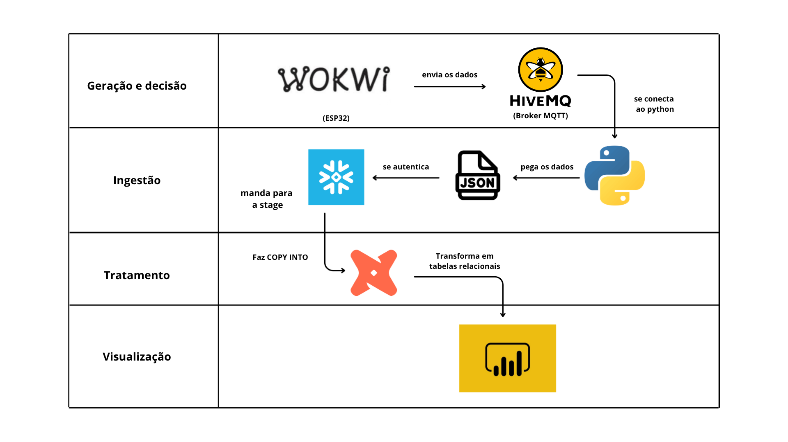
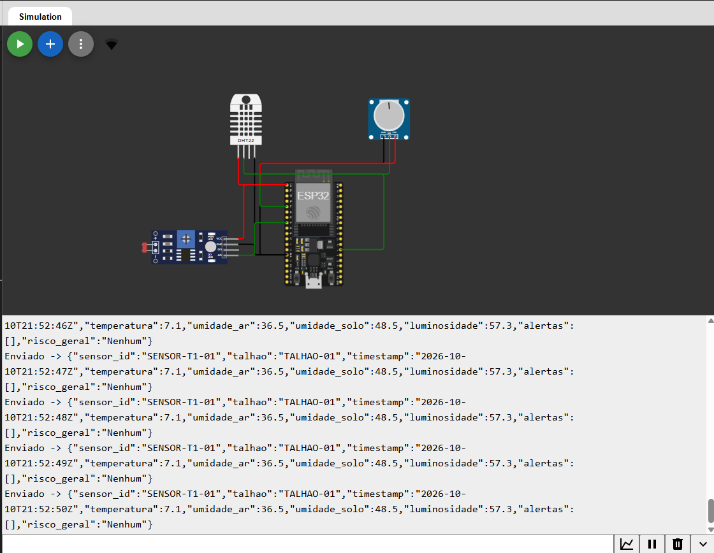
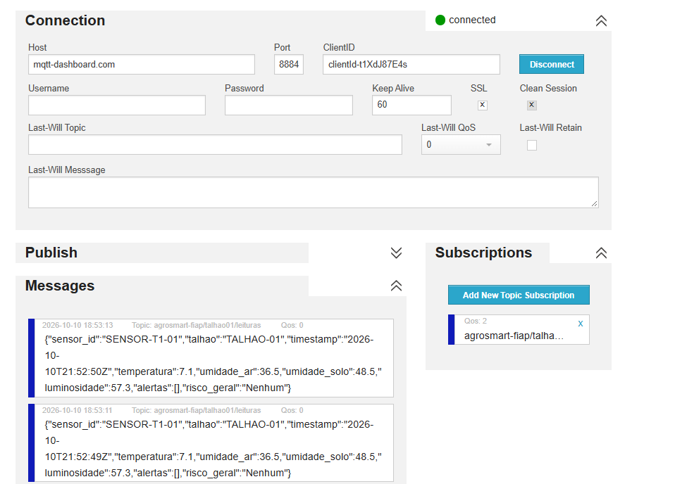
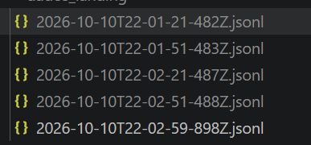
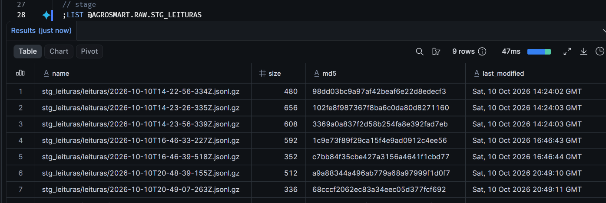
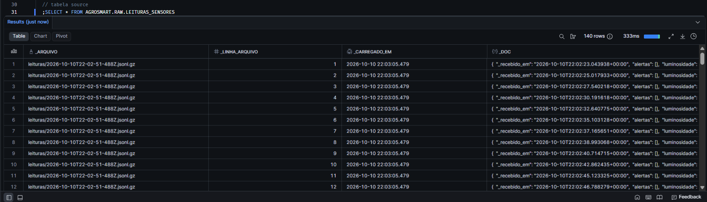
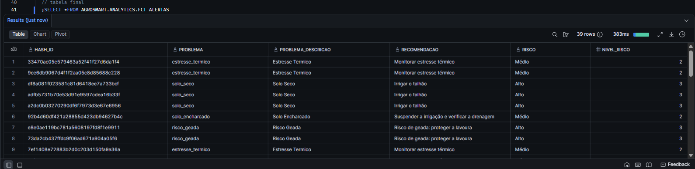
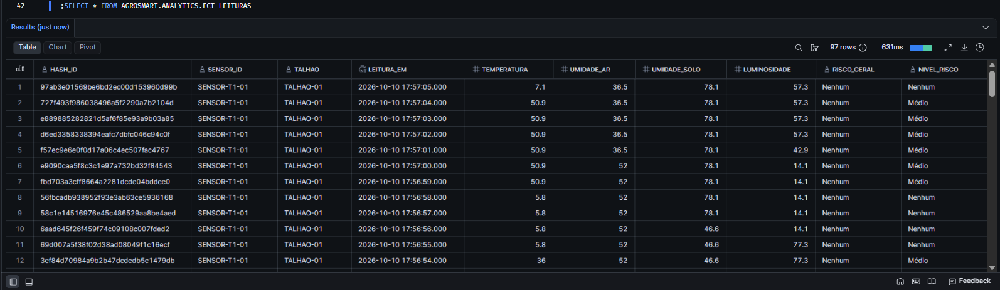
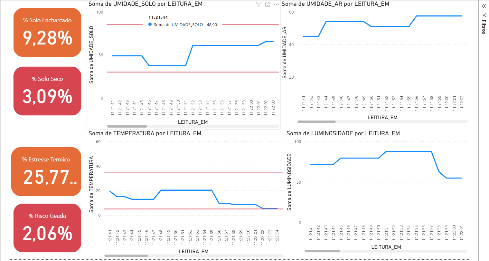

# 🌱 AgroSmart — Fase 6: Plataforma integrada de monitoramento da lavoura

> **Como está a saúde da minha lavoura e o que eu devo fazer agora?**

O AgroSmart usa tecnologia e dados para monitorar a lavoura e apoiar decisões no campo. Nesta Fase 6, a entrega foi fazer uma **pipeline de dados ponta a ponta**: os dados nascem em um sistema embarcado (simulado), são ingeridos, armazenados, tratados, passam por regras de decisão e terminam em um dashboard que mostra o que está acontecendo e o que fazer a seguir.

## 🧭 Grupo

| Nome | RM |
|------|----|
| Henrique Parra | RM551973 |
| Guilherme Barreto | RM97674 |
| Roberto Oliveira | RM551460 |
| Nicolas Oliveira | RM98939 |
| Marcos Vinicius | RM99894 |

---

## Arquitetura

<p align="center">
  
</p>

### Geração e Decisão

O sistema embarcado foi simulado no **Wokwi**, com um **ESP32** ligado a três sensores:

- **DHT22**: mede a temperatura e a umidade do ar;
- **LDR**: mede a luminosidade;
- **Potenciômetro**: simula a umidade do solo.

Ao iniciar a simulação, o **ESP32** se conecta ao **Wi-Fi**, lê os sensores e monta um **JSON** com cada leitura. Esse **JSON** é publicado em um tópico do **HiveMQ**, um **broker MQTT público**. O broker funciona como intermediário: recebe as mensagens do ESP32 e as repassa para quem assinou o tópico. Assim, quem produz o dado e quem consome não precisam se conectar diretamente.

#### Regras simples

| Condição | Risco | Recomendação | Por quê |
|----------|-------|--------------|---------|
| Umidade do solo < 30% | Alto | Irrigar o talhão | A planta começa a sofrer com a falta de água |
| Umidade do solo > 85% | Médio | Suspender a irrigação e verificar a drenagem | Solo encharcado sufoca as raízes e favorece doenças |
| Temperatura > 35 °C | Médio | Monitorar estresse térmico | Calor excessivo reduz a fotossíntese e o crescimento |
| Temperatura < 5 °C | Alto | Risco de geada: proteger a lavoura | Geada pode matar as plantas em poucas horas |

<p align="center">
    
    <br>
    <em>Circuito do ESP32 simulado no Wokwi, com DHT22, LDR e potenciômetro sendo simulado</em>
</p>

<p align="center">
    
    <br>
    <em>Broker MQTT recebendo os dados enviados pelo esp32</em>
</p>


### Ingestão

O script **Python** se conecta ao **HiveMQ**, assina o tópico e passa a receber cada leitura publicada pelo ESP32.

```json
{
  "sensor_id": "SENSOR-T1-01",
  "talhao": "TALHAO-01",
  "timestamp": "2026-10-09T15:00:40Z",
  "temperatura": 72.4,
  "umidade_ar": 64.5,
  "umidade_solo": 6,
  "luminosidade": 93.8,
  "alertas": [
    {
      "problema": "solo_seco",
      "risco": "Alto",
      "recomendacao": "Irrigar o talhão"
    },
    {
      "problema": "estresse_termico",
      "risco": "Médio",
      "recomendacao": "Monitorar estresse térmico"
    }
  ],
  "risco_geral": "Alto",
  "_recebido_em": "2026-10-09T15:01:34.227704+00:00"
}
```

Quando o buffer chega a 20 leituras ou passam 30 segundos, o que acontecer primeiro, as leituras são gravadas em um arquivo **.jsonl**, com um JSON por linha. Ao final da execução, o script se autentica no **Snowflake**, envia os arquivos para a **stage** e executa o `COPY INTO`, que carrega os dados brutos na tabela source.

<p align="center">
    
    <br>
    <em>Arquivo jsonl criado com todos os json recebidos do wokwi</em>
</p>

<p align="center">
    
    <br>
    <em>Depois de ter feito o upload do arquivo jsonl na stage</em>
</p>

<p align="center">
    
    <br>
    <em>Depois de ter feito o copy into e os dados dos arquivos jsonl na tabela do snowflake na source</em>
</p>

### Tratamento

O **dbt** lê a tabela source e transforma os dados em camadas:

- **STG**: converte o JSON bruto em uma tabela relacional, com uma coluna para cada campo e os tipos corretos;
- **FINAL**: expõe os dados prontos para o consumo do Power BI.

<p align="center">
    
    <br>
    <em>Tabela alertas na camada final do dbt</em>
</p>

<p align="center">
    
    <br>
    <em>Tabela leituras na camada final do dbt</em>
</p>

### Visualização

O **Power BI** se conecta à camada FINAL no Snowflake e mostra os indicadores dos sensores, a evolução das leituras no tempo e os alertas gerados pelas regras de decisão. Assim, o produtor consegue responder à pergunta central do projeto: como está a saúde da lavoura e o que fazer agora.

<p align="center">
    
    <br>
    <em>Power bi usando as tabelas da camada final</em>
</p>

## 🎥 Vídeo de demonstração

[Link para o vídeo](https://youtu.be/UhkiySBNCMc)